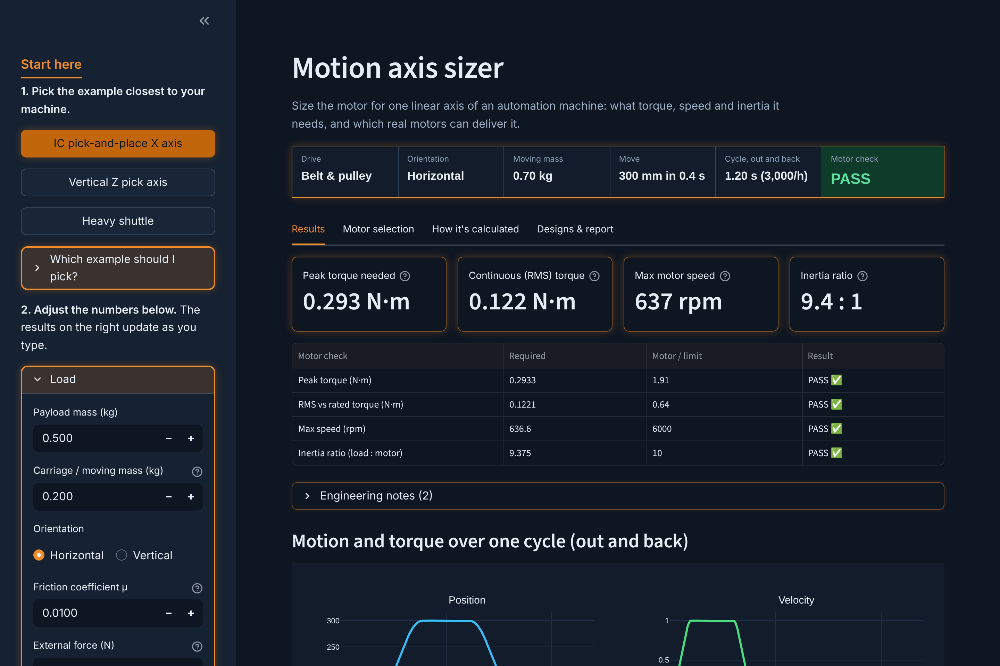
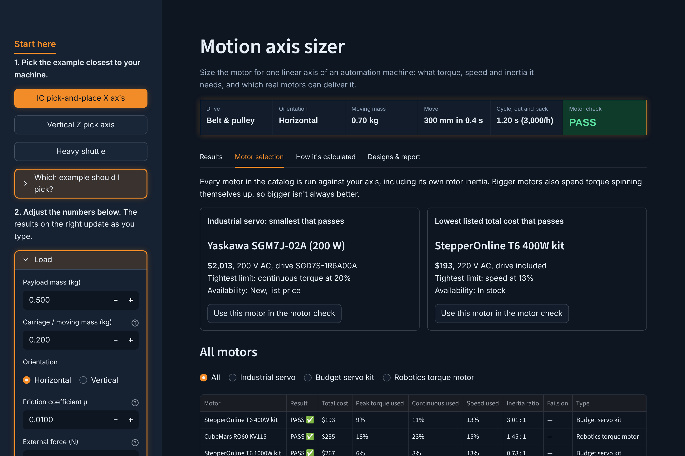

# Motion Axis Sizer

A web tool for sizing the motor on one linear axis of an automation machine, such as the
X, Y or Z axis of a pick-and-place mechanism in a semiconductor test handler.

You describe the axis (load, move and drive). The tool works out the torque, speed and
inertia the motor needs, checks real motors against those numbers, and shows every equation
it used.

**Try it online: https://motion-axis-sizer.streamlit.app**



## What it does

- **Sizes the axis.** S-curve motion profile, forces, drive drag torque, reflected inertia,
  motor speed, and torque at every instant of a full out-and-back cycle (including gravity
  helping on the way down and losses switching direction when the load drives the motor),
  then peak and RMS torque with a safety factor.
- **Handles three drive types**: ball screw, belt and pulley, rack and pinion, with an
  optional gearbox.
- **Checks a motor** from its datasheet. It reports PASS or FAIL on peak torque,
  continuous torque, speed and load-to-rotor inertia ratio, and explains failures in
  plain English.
- **Compares real motors.** Industrial servos (Yaskawa Sigma-7, Panasonic MINAS A6,
  Mitsubishi MELSERVO-JE), budget servo kits (StepperOnline) and robotics torque motors
  (CubeMars), ranked by total cost including the drive. It picks the smallest industrial
  servo that passes and the lowest listed cost that passes.
- **Shows its work.** Every formula is shown with your numbers plugged in and a sentence on
  what it means physically.
- **Saves and compares designs** side by side, and exports a one-page PDF report or a CSV.



## Run it

**Online:** https://motion-axis-sizer.streamlit.app (nothing to install).

**On a Mac:** double-click `Start Motion Sizer.command`. The first run installs what it
needs; after that the tool opens at http://localhost:8501 in a few seconds.

**Anywhere with Python 3.9+:**

```
python3 -m venv .venv
source .venv/bin/activate        # Windows: .venv\Scripts\activate
pip install -r requirements.txt
streamlit run app.py
```

## Check the math

`HAND_CALC.md` works the "Heavy shuttle" example by hand. `test_hand_calc.py` confirms the
app matches it to within 0.1 %:

```
python test_hand_calc.py
```

## Files

| File | What it is |
|---|---|
| `app.py` | The screens: inputs, results, motor selection, equations, designs |
| `sizing.py` | The engineering math and the motor catalog (no screen code) |
| `extras.py` | Datasheet links, saved designs and the PDF report |
| `test_hand_calc.py` | Checks the math against an independent hand calculation |
| `HAND_CALC.md` | The hand calculation, step by step |
| `Start Motion Sizer.command` | Mac: double-click to run the app |
| `Publish to GitHub.command` | Mac: double-click to upload your latest changes to GitHub |
| `datasheets/DATASHEET INDEX.md` | Sources, specs and prices for every motor in the catalog |

## Model assumptions

- S-curve move profile (0 % smoothing = trapezoid), equal acceleration and deceleration times.
- One cycle is move out, dwell, move back, dwell. Vertical axes lift on the way out.
- Guide friction is ignored on vertical axes. External force acts for the whole cycle.
- Drag torque is constant whenever the axis moves.
- Ball screw modeled as a solid steel cylinder; pulleys and pinions as solid discs.
- Not modeled: torque fall-off near top speed, settling, compliance, accuracy and life.
- Coupling inertia and cable carriers are covered by the safety factor.
- Motor prices were checked online on 2026-11-12 and change. Rotor inertia for some
  CubeMars motors is estimated and marked with ≈.

This is an early-sizing tool. Confirm final selections with the manufacturer's sizing software.

## About

Engineering requirements, example axes and verification by Daniel Zubovic, mechanical
engineer. Code written with AI assistance (Claude).
